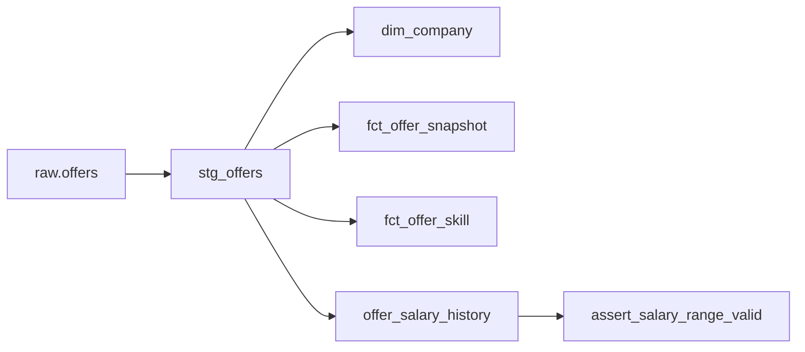

# Data model

## Raw data

| Table | One row means |
|---|---|
| `raw.offers` | An offer seen on one UTC day, with its original JSON |
| `raw.rejected_records` | A rejected record with its error and import ID |
| `raw.ingestion_runs` | An import attempt with its status, mode and counters |

`source_offer_id` is the offer ID from the source.
`raw_offer_id` is the ID of one observation (one offer on one day). `run_id` is the ID of one import.

The offer key is `(source, source_offer_id, UTC date of fetched_at)`.
If an import runs again on the same day, it updates the JSON and `run_id`.
Missing offers stay saved. The next day adds a new observation.

## Data modes

| Mode | Meaning |
|---|---|
| `live` | API data |
| `demo` | Saved sample |
| `legacy_demo` | Old sample imports |
| `unknown` | Unconfirmed source |

A check found 30 rows in Neon that came from the sample.
They were marked as `legacy_demo`, but not deleted.

Models use `live` by default. Demo builds use `demo`.
Both skip `legacy_demo` and `unknown` rows.

## dbt models

| Model | One row means | Stored as |
|---|---|---|
| `stg_offers` | An observation in the selected mode and city | View |
| `dim_company` | A normalized company name | View |
| `fct_offer_snapshot` | An offer seen on one UTC day | Table |
| `fct_offer_skill` | A skill linked to an observation | Table |
| `offer_salary_history` | An original salary variant for an observation | View |

Offer facts link to `dim_company`. Skills link to a specific observation.
Company names use `lower(trim(company_name))`; the key is its MD5 hash.
Skills are trimmed, lowercased and deduplicated.

dbt rebuilds all tables from raw data on every run.
`fct_offer_snapshot` stores one row per offer per day. It is not a dbt SCD2 snapshot.
Salary amounts come from `fromPerUnit` and `toPerUnit`.

## dbt lineage

Arrows show dbt inputs.

## Report rules

Daily reports count offers seen each day.
Other reports count each offer once, using its latest version in the selected period.

In salary averages, each offer counts the same in its group.
If an offer has more than one salary option, we use the average of their minimum salaries.

Salary changes use `LAG()` for the same source, offer, contract, currency, unit and gross/net basis.
The date filter runs after this comparison, so an observation from before the period can be the starting point.
Missing values are not filled in.

## One offer through the system

Example data and IDs below are made up.

1. The API returns slug `example-python`, company `Example`, city `Poznań`,
   level `junior`, skill `Python` and a monthly B2B net PLN range of 10,000–15,000.
2. Python validates the offer and keeps its original JSON.
3. The import saves it with source `justjoin.it`, `source_offer_id = example-python`,
   `raw_offer_id = 101` and the import's `run_id`.
   Its observation day comes from `fetched_at`, not the publication date.
4. dbt creates one offer-day row, a linked `python` skill row and a salary variant.
5. If this were the only offer that day, the report would show one offer and 100% juniors.
   Its salary group would have a mean advertised minimum of PLN 10,000.
6. A same-day repeat updates observation 101. The next day creates another, such as 102.

Across both days, daily counts include two observations.
Company and skill summaries count one unique offer using observation 102.
A report for only the first day uses observation 101.
